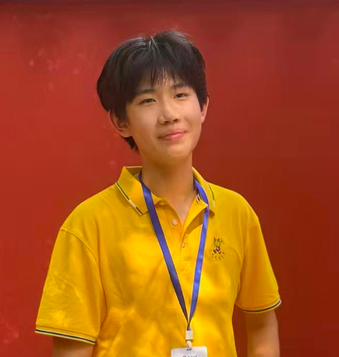
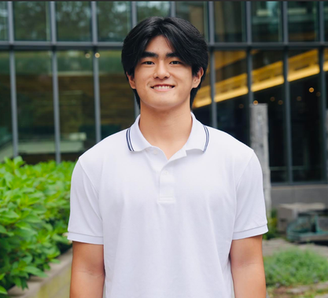
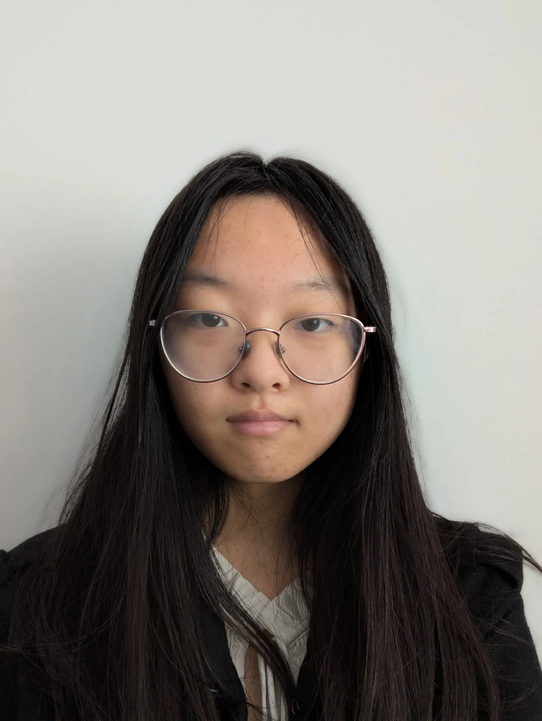
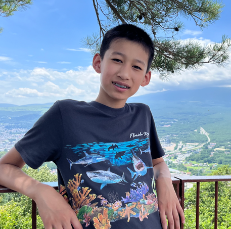
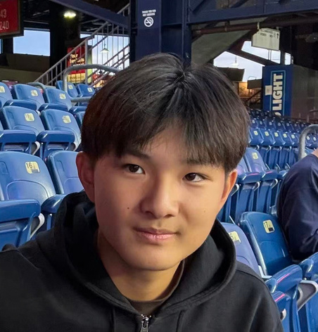
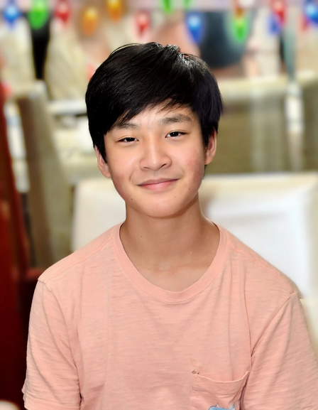
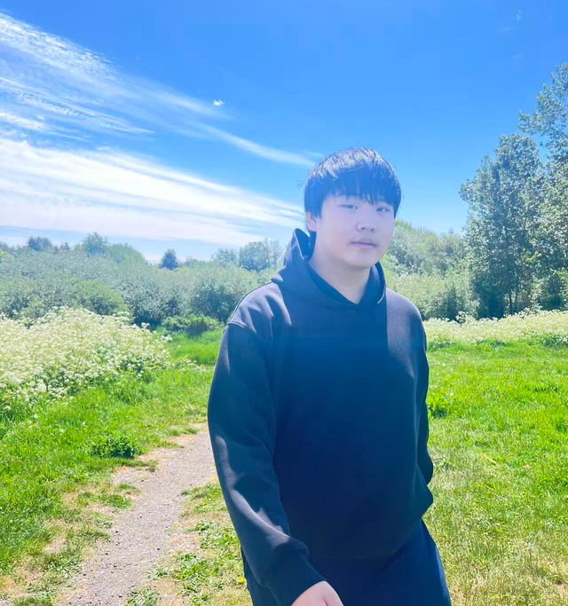
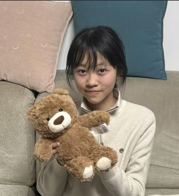
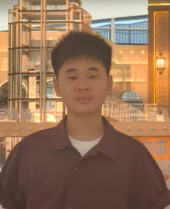

QUBE Initiative is a global youth-led nonprofit spanning **3 countries** (United States, Canada, and China) and **8 states in the USA**. Below are our regional branch leaders:

## United States Branches

:::: {.profile-grid}

::: {.branch-card}
{alt="Jacob Fu"}

### Jacob Fu
[Washington]{.badge-role}
:::

::: {.branch-card}
{alt="Balwyn Jing"}

### Balwyn Jing
[Maryland]{.badge-role}
:::

::: {.branch-card}
{alt="Maxime Song"}

### Maxime Song
[Michigan]{.badge-role}
:::

::: {.branch-card}
{alt="Albert Li"}

### Albert Li
[Illinois]{.badge-role}
:::

::: {.branch-card}
{alt="Katie Yang"}

### Katie Yang
[New Jersey]{.badge-role}
:::

::: {.branch-card}
{alt="Alex Liu"}

### Alex Liu
[Massachusetts]{.badge-role}
:::

::: {.branch-card}
{alt="Lucus Tian"}

### Lucus Tian
[Ohio]{.badge-role}
:::

::: {.branch-card}
### Kyle Huang
[Pennsylvania]{.badge-role}
:::

::::

## International Branches

:::: {.profile-grid}

::: {.branch-card}
{alt="Alex Zang"}

### Alex Zang
[Canada]{.badge-role}
:::

::: {.branch-card}
{alt="Lianghui Shi"}

### Lianghui Shi
[Hefei, China]{.badge-role}
:::

::: {.branch-card}
{alt="George Lv"}

### George Lv
[Nanjing, China]{.badge-role}
:::

::::

---

Interested in joining or starting a branch? Contact us at [qubeinitiative1@gmail.com](mailto:qubeinitiative1@gmail.com) or explore the [QUBE Youth Scholars Network](../programs/youth-scholars-network.qmd).
