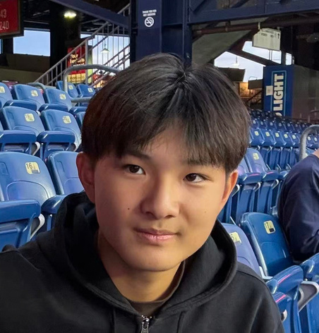

Our Executive Committee leads QUBE Initiative's mission to empower young minds at the intersection of data, biology, medicine, and public health.

::: {.qube-card}
::: {.profile-row}
::: {.profile-photo-frame}
{.portrait-img alt="Michelle Zhang"}
:::
::: {.profile-info}
### Michelle Zhang
[Founder and President]{.badge-role}

Leads QUBE Initiative's overall vision, strategic growth, and organizational direction across all branches and programs.
:::
:::
:::

::: {.qube-card}
::: {.profile-row}
::: {.profile-photo-frame}
{.portrait-img alt="Alex Liu"}
:::
::: {.profile-info}
### Alex Liu
[Director of Communications and Outreach]{.badge-role}

Oversees external communications, community engagement, and outreach efforts connecting students, educators, and chapters.
:::
:::
:::

::: {.qube-card}
::: {.profile-row}
::: {.profile-photo-frame}
{.portrait-img alt="Maxime Song"}
:::
::: {.profile-info}
### Maxime Song
[Director of Programs]{.badge-role}

Directs QUBE's educational programming, curriculum initiatives, and student research opportunities.
:::
:::
:::

---

See also: [Branch Leadership](branch-leadership.qmd) | [Advisors](advisors.qmd) | [Programs](../programs/index.qmd)
