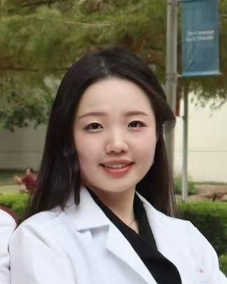

Welcome to the **2026 QUBE Science and Leadership Forum**! Each month, researchers, clinicians, and industry leaders share how mathematics, statistics, and data science solve real-world challenges in medicine, biotechnology, and public health.

- **Time:** 9:00–10:00 PM EST
- **Zoom ID:** `914 6192 5123`

## 2026 Seminar Schedule at a Glance

| Month | Date & Time (EST) | Seminar Title | Speaker | Affiliation |
|---|---|---|---|---|
| **January** | Jan 23, 2026 (9–10 PM) | *Saving Lives with Data: How Math Helps Kidney Transplants* | **Lingxuan Kong, MS** | PhD Candidate, University of Michigan |
| **February** | Feb 27, 2026 (9–10 PM) | *Data Science Research Applications in Medicine* | **Yingchao Zhong, MD PhD** | Clinical Assistant Professor, Stanford University |
| **March** | March 27, 2026 (9–10 PM) | *How Statistics Helps Decide Which Treatments Work: Inside Clinical Trial Design* | **Tianyi Chu (MS, Yale '24)** | PhD Student, MD Anderson Cancer Center |
| **April** | April 27, 2026 (9–10 PM) | *What is Environmental Health and Why Does it Matter?* | **Jackie Goodrich, PhD** | Research Professor, Environmental Health Sciences, University of Michigan |
| **May** | May 22, 2026 (9–10 PM) | *Clinical Research and Drug Development: Education to Careers* | **Kelly Speth, PhD** | Associate Director, Kite Pharma |
| **June** | June 12, 2026 (9–10 PM) | *Turning Data into Real-World Innovation: From Math to Data Science* | **Yi Zhao, PhD** | Senior Data Scientist, Apple |
| **July** | July 31, 2026 (9–10 PM) | *The Statistician as a Strategic Drug Developer: Life in the Biotechnology Industry* | **Paul Manser, PhD** | Director of Biostatistics, Biogen West Coast Hub |

---

## Seminar Details

::: {.qube-card}
::: {.profile-row}
::: {.profile-photo-frame}
{.portrait-img alt="Lingxuan Kong, MS"}
:::
::: {.profile-info}
### January Seminar: Saving Lives with Data: How Math Helps Kidney Transplants
[Jan 23, 2026 | 9:00–10:00 PM EST | Zoom ID: 914 6192 5123]{.badge-role}

- **Speaker:** Lingxuan Kong, MS
- **Role & Affiliation:** PhD Candidate, University of Michigan
:::
:::
:::

::: {.qube-card}
::: {.profile-row}
::: {.profile-photo-frame}
{.portrait-img alt="Yingchao Zhong, MD PhD"}
:::
::: {.profile-info}
### February Seminar: Data Science Research Applications in Medicine
[Feb 27, 2026 | 9:00–10:00 PM EST | Zoom ID: 914 6192 5123]{.badge-role}

- **Speaker:** Yingchao Zhong, MD PhD
- **Role & Affiliation:** Clinical Assistant Professor, Stanford University
:::
:::
:::

::: {.qube-card}
::: {.profile-row}
::: {.profile-photo-frame}
{.portrait-img alt="Tianyi Chu"}
:::
::: {.profile-info}
### March Seminar: How Statistics Helps Decide Which Treatments Work: Inside Clinical Trial Design
[March 27, 2026 | 9:00–10:00 PM EST | Zoom ID: 914 6192 5123]{.badge-role}

- **Speaker:** Tianyi Chu (MS, Yale '24)
- **Role & Affiliation:** PhD Student, MD Anderson Cancer Center
:::
:::
:::

::: {.qube-card}
::: {.profile-row}
::: {.profile-photo-frame}
{.portrait-img alt="Jackie Goodrich, PhD"}
:::
::: {.profile-info}
### April Seminar: What is Environmental Health and Why Does it Matter?
[April 27, 2026 | 9:00–10:00 PM EST | Zoom ID: 914 6192 5123]{.badge-role}

- **Speaker:** Jackie Goodrich, PhD
- **Role & Affiliation:** Research Professor, Environmental Health Sciences, University of Michigan
:::
:::
:::

::: {.qube-card}
::: {.profile-row}
::: {.profile-photo-frame}
{.portrait-img alt="Kelly Speth, PhD"}
:::
::: {.profile-info}
### May Seminar: Clinical Research and Drug Development: Education to Careers
[May 22, 2026 | 9:00–10:00 PM EST | Zoom ID: 914 6192 5123]{.badge-role}

- **Speaker:** Kelly Speth, PhD
- **Role & Affiliation:** Associate Director, Kite Pharma
:::
:::
:::

::: {.qube-card}
::: {.profile-row}
::: {.profile-photo-frame}
{.portrait-img alt="Yi Zhao, PhD"}
:::
::: {.profile-info}
### June Seminar: Turning Data into Real-World Innovation: From Math to Data Science
[June 12, 2026 | 9:00–10:00 PM EST | Zoom ID: 914 6192 5123]{.badge-role}

- **Speaker:** Yi Zhao, PhD
- **Role & Affiliation:** Senior Data Scientist, Apple
:::
:::
:::

::: {.qube-card}
::: {.profile-row}
::: {.profile-photo-frame}
{.portrait-img alt="Paul Manser, PhD"}
:::
::: {.profile-info}
### July Seminar: The Statistician as a Strategic Drug Developer: Life in the Biotechnology Industry
[July 31, 2026 | 9:00–10:00 PM EST | Zoom ID: 914 6192 5123]{.badge-role}

- **Speaker:** Paul Manser, PhD
- **Role & Affiliation:** Director of Biostatistics, Biogen West Coast Hub
:::
:::
:::

---

[← QUBE Discovery Lab](discovery-lab.qmd) | [Back to All Programs](index.qmd) | [Next: QUBE Youth Research Showcase Symposium →](research-showcase-symposium.qmd)
